<div align="center">

<picture>
  <source media="(prefers-color-scheme: dark)" srcset="docs/img/logo-dark.svg">
  
</picture>

## Light up your gateways.

### See your HAProxy and NGINX the way you think about them: as a map.

Relationship maps · live health · charts with history · config audit · offline config review.<br>
One portal for both. Free, open source, and nothing to build.

[](https://github.com/Cloudlative/gatelight/actions/workflows/ci.yml)
[](https://github.com/Cloudlative/gatelight/pkgs/container/gatelight)
[](LICENSE)
[](#what-each-data-source-gives-you)
[](#what-each-data-source-gives-you)
[](package.json)

[**Website**](https://gatelight.cloudlative.com/) · [**Quick setup**](#quick-setup-two-minutes) · [**Why**](#why-gatelight-exists) · [**Highlights**](#highlights) · [**Screenshots**](#screenshots) · [**Configure**](#configuring-instances) · [**Security**](#security-model) · [**Contribute**](CONTRIBUTING.md)

<br>

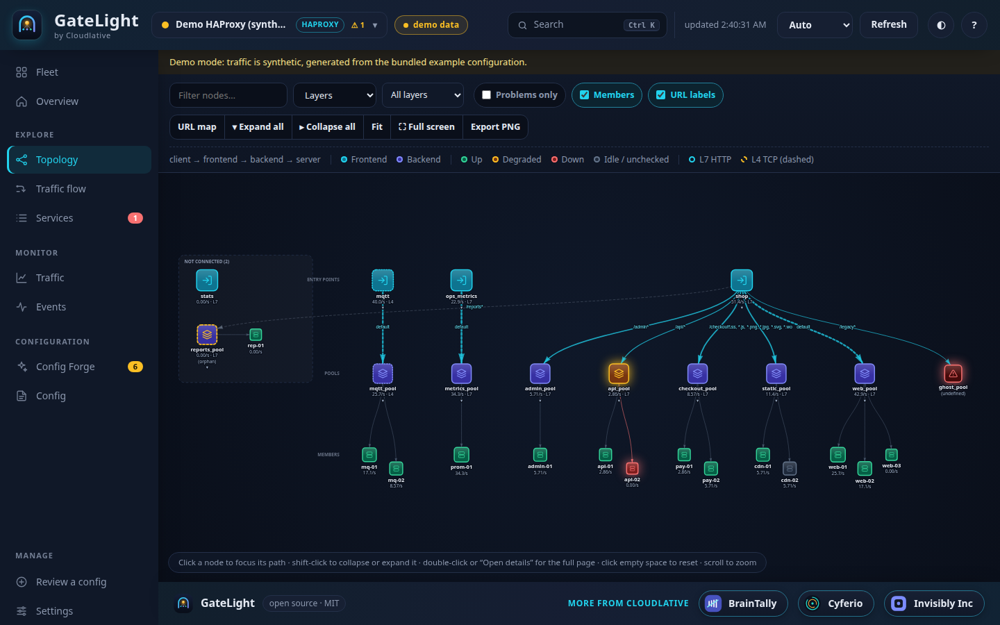

</div>

<br>

## Quick setup (two minutes)

You need Docker with the Compose plugin. Nothing else: no clone, no build.

```bash
curl -fsSL https://raw.githubusercontent.com/Cloudlative/gatelight/main/docker-compose.yml -o docker-compose.yml
docker compose up -d
```

Open **http://localhost:3000**, then:

1. **Sign in.** The first start generates a password and prints it once:
   ```bash
   docker compose logs gatelight | grep "FIRST RUN"
   ```
   The user is `admin`. Prefer your own? Put `AUTH_PASS=...` in a `.env` file next to the compose file (see [Environment](#environment)).
2. **Add an instance** (Overview → *Add an instance*). Pick HAProxy or NGINX, enter the stats URL, username and password, press *Test connection*, then *Save & connect*.
   Running on the same machine as Docker? Use `http://host.docker.internal:PORT/stats` instead of `localhost`.
3. **Explore.** Overview, Topology, Infrastructure, Graphs, Services and Config audit fill in right away.

**Upgrading later?** `docker compose pull && docker compose up -d`: your connections, history and sign-in are kept in a Docker volume ([details below](#upgrading-is-one-command-and-your-data-stays)).

Just want to look around first? `DEMO_MODE=true docker compose up -d` serves synthetic traffic on a sample shop, no servers needed.
Only want the map of a config file? Open *Review a config*, drop a `haproxy.cfg` / `nginx.conf` (or a whole folder), and nothing is saved.

<details>
<summary><b>Useful options</b></summary>

| Want to… | Do this |
|---|---|
| Use another port | `GATELIGHT_PORT=8080 docker compose up -d` |
| Reach it from other machines | `GATELIGHT_BIND=0.0.0.0` and put **HTTPS in front first** |
| Pin a version | `GATELIGHT_VERSION=3.0.0 docker compose up -d` (tags: `latest`, `3.0.0`, `3.0`) |
| Upgrade | `docker compose pull && docker compose up -d` (your data volume is kept, see [Upgrading](#upgrading-is-one-command-and-your-data-stays)) |
| Choose the password | `AUTH_PASS=... docker compose up -d`, or a hash: `printf '%s' 'pw' \| docker run -i --rm ghcr.io/cloudlative/gatelight node src/cli.js hash-password` |
| Forget the generated password | `docker compose exec gatelight cat /app/data/.initial-password` |
| Run from source | `git clone` the repo and `docker compose up -d --build` (the override file builds locally), or `npm ci && DEMO_MODE=true npm start` (Node 22.5+) |

</details>

### Upgrading is one command, and your data stays

```bash
docker compose pull && docker compose up -d
```

That is the whole upgrade. Compose downloads the newer image, replaces the container and starts it; the **`gatelight-data` volume is not touched**, so nothing has to be re-entered. It takes a few seconds and the dashboard is back, with:

| Kept across upgrades, restarts and re-creates | Where (inside the volume, `/app/data`) |
|---|---|
| Saved connections: URLs, credentials, uploaded config files | `ui-instances.json` |
| Chart history and the events timeline (SQLite, 14 days by default) | `history.db` |
| The sign-in session secret, so nobody is signed out by an upgrade | `.auth-secret` |
| The generated first-run password, if you did not set `AUTH_PASS` | `.initial-password` |

Good to know:

- **Your own settings** live in `.env` next to the compose file, so they survive too. Nothing in the image needs editing.
- **Pin a release** if you want upgrades to be deliberate: `GATELIGHT_VERSION=3.0.0` in `.env` (tags: `latest`, `3.0.0`, `3.0`). **Roll back** by setting the old tag and running `docker compose up -d`.
- **History retention** is `HISTORY_KEEP_DAYS` (default 14); raw samples are rolled up to one-minute averages after `HISTORY_RAW_HOURS` (default 6) to keep the file small.
- `docker compose down` keeps the volume. Only `docker compose down -v` deletes it, so avoid `-v` unless you mean it.
- The container itself is stateless and read-only; the volume is the only thing worth backing up.

Back up and restore the volume:

```bash
# back up
docker run --rm -v gatelight_gatelight-data:/data -v "$PWD":/backup alpine tar czf /backup/gatelight-data.tgz -C /data .
# restore (into an empty volume, with GateLight stopped)
docker compose down
docker run --rm -v gatelight_gatelight-data:/data -v "$PWD":/backup alpine sh -c "cd /data && tar xzf /backup/gatelight-data.tgz"
docker compose up -d
```

The volume is named `<project>_gatelight-data`; with the default compose project name that is `gatelight_gatelight-data` (check with `docker volume ls`).

## Why GateLight exists

We run HAProxy and NGINX in front of real systems, and we kept hitting the same wall: **the built-in views are bad.**

- **The HAProxy stats page is a wall of tables.** Dozens of columns, one row per server, no sense of *which URL goes where*, no history, no charts, and no way to tell a healthy-but-idle server from a dead one at a glance. When something breaks you read numbers instead of seeing the problem.
- **NGINX has no UI at all.** Open-source NGINX gives you `stub_status`: four numbers for the whole instance. No per-upstream health, no per-server traffic. The nice dashboard is a paid NGINX Plus feature.
- **Neither shows how things relate.** Which frontend or `server {}` block routes `/api` to which pool? Which servers sit behind it? Is the config on disk even what is running? You reconstruct it by reading config files by hand.
- **Config mistakes stay invisible** until a reload goes wrong: undefined backends, orphaned pools, servers without health checks, plaintext passwords, exposed stats pages.

GateLight reads your config and your live stats and draws the whole picture: **which URL goes to which backend, which servers sit behind it, what is healthy right now, and what changed.**

| | HAProxy stats page / NGINX `stub_status` | GateLight |
|---|---|---|
| Relationships | none | frontend → rule → pool → server map, four layouts |
| URLs and paths | not shown | every host/path → target, searchable URL map |
| Health | tables of status text | colour-coded, grouped, with reason and time in state |
| History | none | charts with zoom/pan, kept in SQLite, 5 min to 7 days |
| NGINX upstream health | none (open source) | per-server via Plus API or active TCP probe |
| Config problems | none | 39 audit rules with line numbers and fixes |
| Changes | none | event timeline, webhook alerts |
| Setup | built in | `docker compose up -d` |

## Highlights

**See**
- **Relationship map**: frontends / `server {}` blocks → routing rules (`use_backend … if acl`, `location /x`) → backends / upstreams → servers. Live status colours, traffic-weighted edges, orphans and broken routes highlighted, click a node to focus its path, double-click for its details page, PNG export, full-screen mode.
- **Four layouts**: *Layers*, *Flow*, *Mind map* (shows the URIs each node handles) and *Tree* (a `tree`-style outline you can fold and copy).
- **Infrastructure**: the infrastructure behind the load balancer with an aliveness status per server, as a foldable hierarchy (load balancer → networks → hosts → services), or grouped by pool or by host, with "only alive" / "only not alive" filters.
- **Graphs**: Grafana-style charts for requests/s, session rate, sessions, 5xx, throughput, response time and servers up/down, plus a chart per server, pool and frontend. Drag to zoom, ✋ to pan, step through time, shared crosshair, clickable legends with per-series stats, full-screen. HTTP response and error **donut charts** per instance and per backend.
- **Services table**: status, IP, port, which frontends reach it, where it leads, sessions, req/s, 5xx/s, trend. Charts on top follow your filters.
- **Details pages**: click any row, chip or node for a page of its own: health, metrics, relationships, trend, configuration, events and audit findings, with a shareable link and working Back/Forward.

**Know**
- **Live health**: HAProxy via the stats CSV or the Runtime API; NGINX via `stub_status`, the NGINX Plus API, and/or an active TCP probe of every upstream (so even open-source NGINX gets per-server health).
- **Config audit (39 rules)**: undefined backends/upstreams, orphaned pools, missing health checks, single points of failure, weak or plaintext credentials, exposed stats / `stub_status`, legacy TLS, path-traversal-prone `alias`, deprecated directives, **config drift** (file ≠ running process), and more. Charts show where the findings cluster.
- **History that survives restarts**: samples and events are stored in SQLite (raw for 6 hours, then 1-minute averages for 14 days).
- **Alerting & observability**: Slack / Mattermost / Teams-compatible webhooks on down and recovery; Prometheus `/metrics`.

**Use it your way**
- **Review a config offline**: drop a `haproxy.cfg`, an `nginx.conf` or a **whole folder** (with `conf.d/` includes). Nothing is saved; it is analysed in memory and cleared with one click.
- **Keep configs as named instances** and **Update config** whenever the file changes: the map, audit and URL map are rebuilt and anything that disappeared is dropped.
- **Connect from the browser**: add a server (URL, user, password) in the UI. Connections are private to the browser that added them.
- **CI-ready CLI**: `gatelight audit haproxy.cfg --fail-on error`, with GitHub annotation output.

**Built for real teams**
- Password **sign-in** (hashed passwords supported), a profile page, multi-instance fleet view, secret redaction everywhere, strict CSP, no CDN dependencies (works air-gapped), light and dark themes, command palette (`Ctrl/⌘ K`), keyboard shortcuts.


## Validate a config against a specific version

The **Validate** page checks a configuration against the official documentation of the exact release you run (or plan to run), and adds recommendations that depend on that version.

- **HAProxy 1.7 → 3.4** and **NGINX up to the latest release**; pick the target version, or let GateLight use the one the running instance reports.
- Checks every keyword, section/context, bind and server option, rule action, sample fetch and converter, parameter, variable and `%[...]` expression, not only the ones the map understands. It handles line continuations, quoting, `${ENV}`, HAProxy `.if version_atleast(...)` blocks, nested NGINX contexts, `include`d files, `stream`/`mail`, regex captures and third-party (Lua/njs) blocks.
- Tells you *what exactly is wrong for that version*: unknown (with "did you mean"), **too new** ("needs ≥ 2.5"), **removed** ("gone after 2.4, use `nbthread`"), **deprecated**, wrong section/context, bad arguments, duplicates, undefined zones, `proxy_pass` URI rules, syntax errors with file and line.
- Version-aware recommendations, for example upstream keep-alive before/after NGINX 1.29.7, `http2 on;` vs `listen ... http2` from 1.25.1, `http-after-response` from HAProxy 2.2, `add_header` inheritance, weak ciphers, health-check style.
- Optional: paste `nginx -V` to also catch directives whose module is not compiled into your binary.
- Works for connected instances and for offline "Review a config". API: `POST /api/validate`, `GET /api/instances/:id/validate?version=`, `GET /api/validate/versions`.

The rules are not hand-typed: `npm run kb:build` re-reads the official manuals (docs.haproxy.org for every version, nginx.org directive reference and changelog) and regenerates `src/kb/*.json`, so supporting a new release is one command.

## Traffic flow: listener port to backend port, and what happens to the URI

The **Traffic flow** page answers "if a client asks for this, where does it go, and what does my backend actually receive?", from the configuration alone (nothing is sent to your servers).

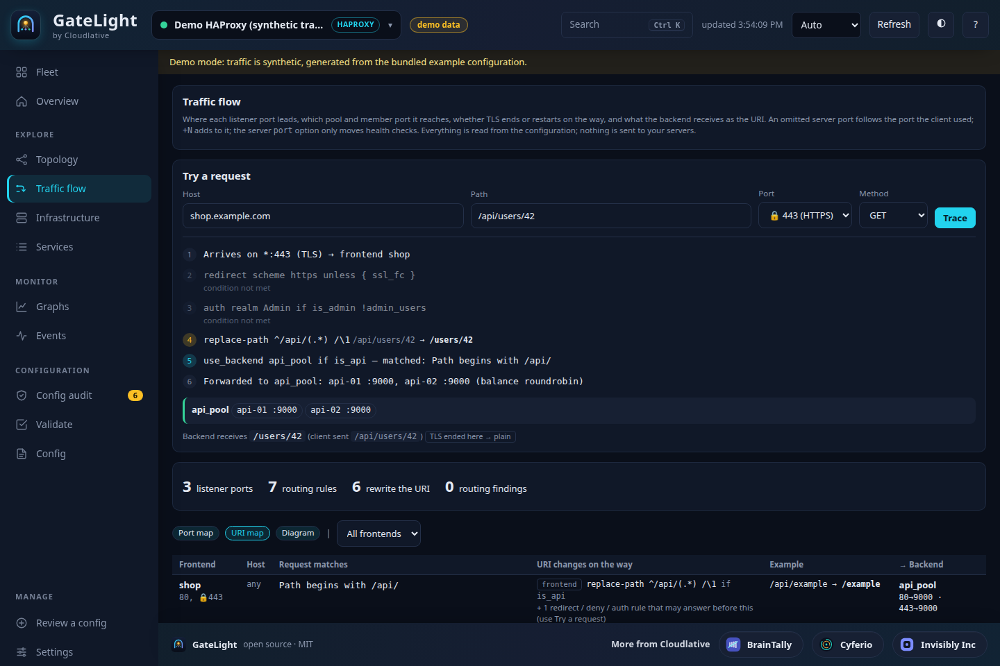

- **Port map**: every listener port, the frontend and pool it reaches, the backend port(s), and whether TLS ends at the proxy, is re-encrypted, or passes through.
- **URI map**: for each routing rule, the match, the rewrites that run (`replace-path`, `set-path`, `set-uri`, `rewrite`, the URI part of `proxy_pass`, `proxy_set_header Host`), and an example such as `/api/users` becoming `/users`.
- **Diagram**: listeners, rules and pools in three columns, with `listener→backend` ports on the lines.
- **Try a request**: enter host, path, port and method and follow it step by step: the redirect or auth rule that fires, the rule that wins, the rewrite, the member ports it reaches.
- **Routing findings**: rules that can never match because an earlier one catches everything, health checks that probe a different port than traffic, TLS spoken to `:80` or plain traffic sent to `:443`, a server that points at the proxy's own listener, the classic NGINX trailing-slash mismatch, `rewrite … break` silently ignoring the `proxy_pass` URI.
- The same details appear in the Topology hover text and in the routing-rule inspector.
- **L7 vs L4**: the topology labels every frontend and pool as **L7** (HTTP: host, path, headers, rewrites) or **L4** (TCP: ports and TLS SNI only, shown dashed), with a layer filter and a tooltip saying what that layer can and cannot see.

It follows the official semantics. In HAProxy, a server written without a port uses **the port the client connected to**, `10.0.0.1:+1000` adds 1000 to it, and the server `port` option only moves **health checks**; `use_backend` rules are first match, frontend `http-request` rules run before the backend is chosen and backend ones after. In NGINX, a URI in `proxy_pass` replaces the matched location prefix, `^~` stops regex checks, and `rewrite … break` keeps the rewritten URI. Conditions that depend on headers or source IP cannot be decided from host, path and port, so they are marked as skipped or "approximate" rather than guessed. API: `GET /api/instances/:id/flow`, `POST /api/instances/:id/flow/trace`, `POST /api/flow` (for a pasted config).

## Screenshots

<table>
<tr>
<td width="50%">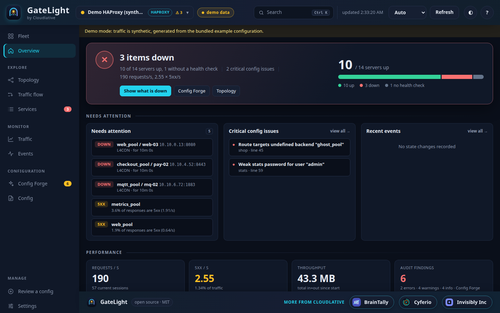<br><sub><b>Overview</b>: explained, clickable health cards, traffic chart, what needs attention.</sub></td>
<td width="50%">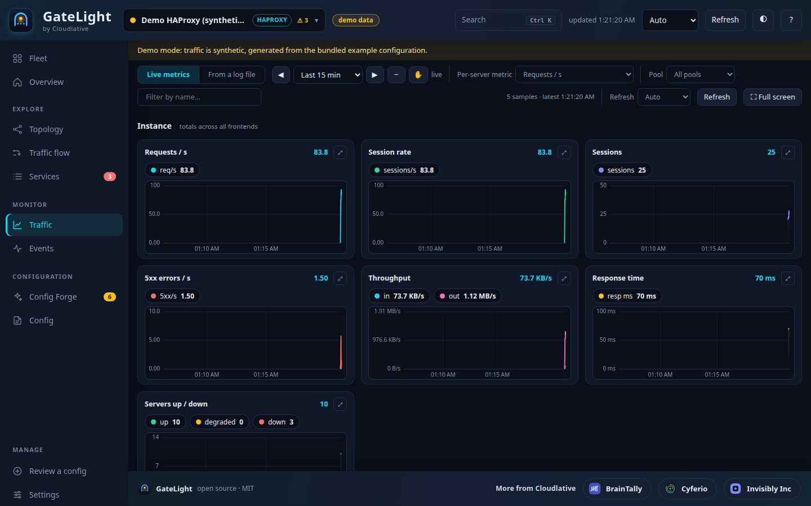<br><sub><b>Graphs</b>: zoom, pan, shared crosshair, clickable legends, donut charts for HTTP errors.</sub></td>
</tr>
<tr>
<td width="50%">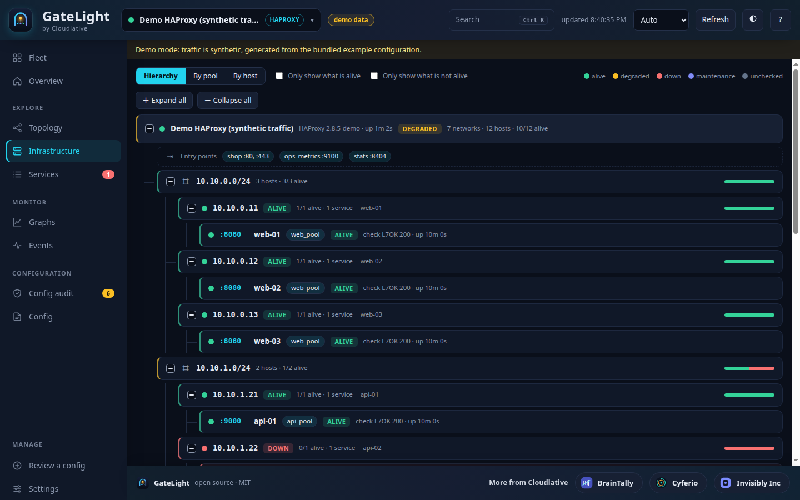<br><sub><b>Infrastructure</b>: networks, hosts and services behind the load balancer, in a foldable hierarchy with aliveness.</sub></td>
<td width="50%">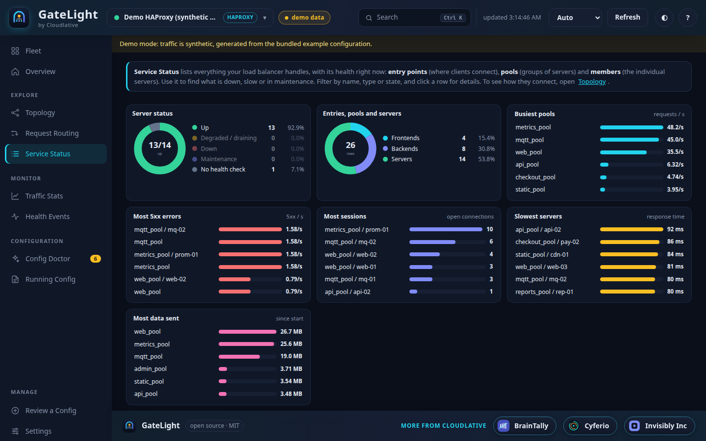<br><sub><b>Services</b>: IP, port, who reaches it, where it leads, with charts for the current filter.</sub></td>
</tr>
<tr>
<td width="50%">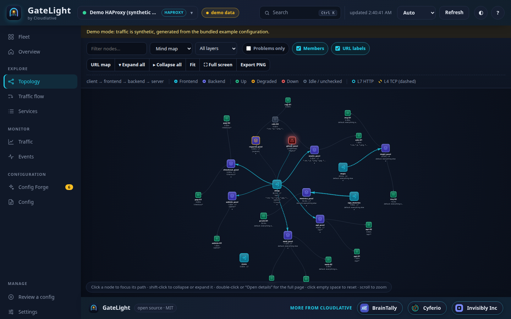<br><sub><b>Mind map</b>: every node shows the URIs it handles.</sub></td>
<td width="50%">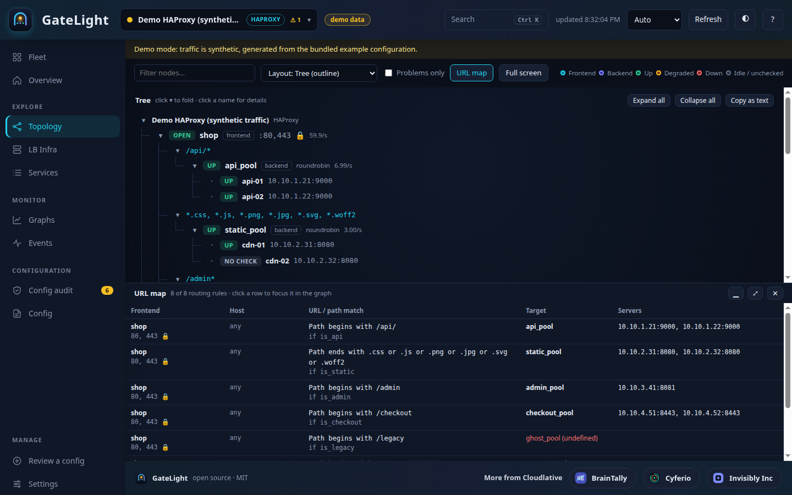<br><sub><b>Tree</b>: the whole estate as a foldable outline, copyable as text.</sub></td>
</tr>
<tr>
<td width="50%">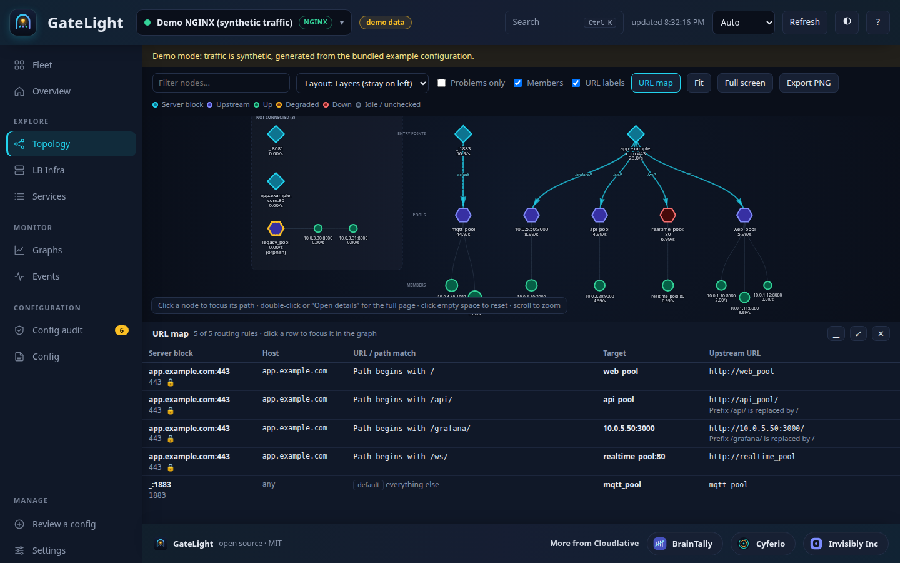<br><sub><b>NGINX too</b>: server blocks, locations and upstreams, plus a resizable URL map.</sub></td>
<td width="50%">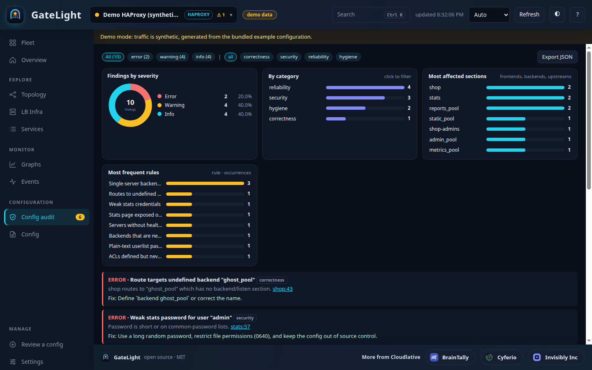<br><sub><b>Config audit</b>: every finding has a line number and a fix, with charts.</sub></td>
</tr>
<tr>
<td width="50%">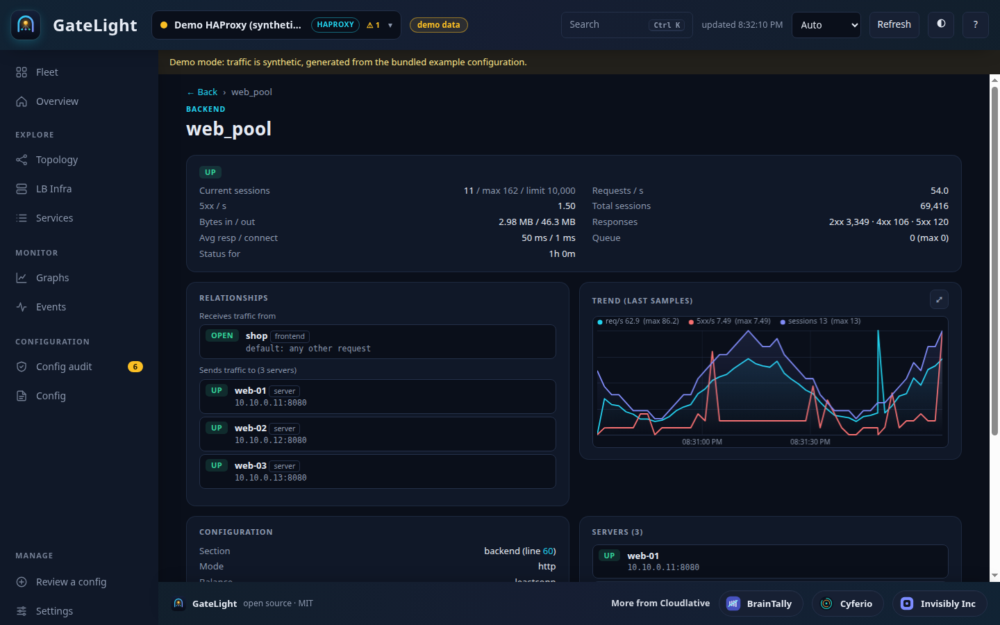<br><sub><b>Details</b>: a page per item, not a panel in the way.</sub></td>
<td width="50%">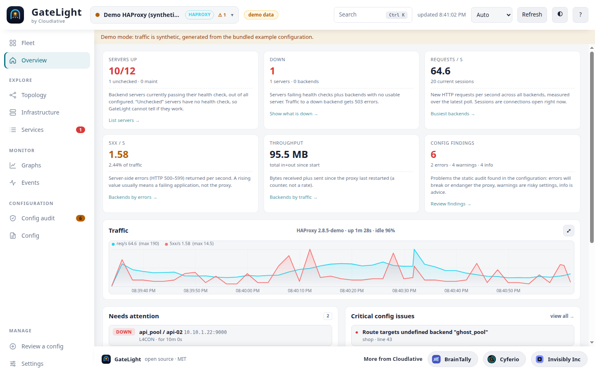<br><sub><b>Light and dark</b> themes.</sub></td>
</tr>
</table>

## Using the dashboard

| You want to… | Do this |
|---|---|
| Watch a live server | **Add instance** → pick HAProxy or NGINX → stats URL, user, password → *Test connection* → *Save & connect* |
| Check a config before a reload | **Add instance** → *Review a config* → drop it. Nothing is stored |
| Keep several configs side by side | In the review header press **Save as instance…**, or upload a config in *Add instance* without a URL |
| Refresh a saved config after editing it | **Update config** (header, Config page, or Settings): drop the new file or folder |
| Look back in time | **Graphs**: pick a range (5 min to 7 days), drag a chart to zoom, ✋ to pan |
| Find what is down | **Infrastructure** → *Only show what is not alive*, or **Overview** → *Down* |
| Get back to the overview | Click the **GateLight logo** at any time |

### Prepare your load balancers

GateLight only needs a read-only stats endpoint.

**HAProxy**: enable the stats page (GateLight appends `;csv` itself):

```haproxy
listen stats
    bind 127.0.0.1:8404
    stats enable
    stats uri /stats
    stats auth viewer:a-long-random-password   # or restrict by network instead
```

**NGINX**: expose `stub_status` (and, optionally, the Plus API). Open-source NGINX has no per-upstream stats, so GateLight can also TCP-probe each upstream server:

```nginx
server {
    listen 127.0.0.1:8081;
    location /nginx_status { stub_status; allow 127.0.0.1; deny all; }
}
```

## Connect a server from the UI

The **Add instance** page is on by default in the Docker setup (`ALLOW_UI_INSTANCES=true`). Saved connections live in the `gatelight-data` volume
(`/app/data/ui-instances.json`, mode 0600), survive restarts, and can be edited or removed under *Settings*. Passwords are
never returned by the API. Upload a config (files, a whole folder with `conf.d/` includes, or paste) to get the relationship map and audit as well. With no URL it is saved as a **config-only instance**, which is how you keep several HAProxy / NGINX configs side by side under unique names. Nothing is read from the server's disk: GateLight does not look for `haproxy.cfg` / `nginx.conf` on its own.

**Connections are private to the browser that added them.** Each browser gets a random `gl_sid` cookie (HttpOnly, SameSite=Strict);
only its SHA-256 is stored next to the connection, so a different browser or profile sees an empty list and is asked for credentials.
Idle connections are deleted after `UI_INSTANCE_TTL_DAYS` (default 7). For a shared team deployment set `UI_INSTANCES_SHARED=true`.
This is separation, not authentication: keep sign-in on, and use HTTPS, since the stats credentials you type travel to the server.

Things worth knowing: anyone who can use the UI can make GateLight connect to hosts of their choosing, so keep sign-in on
and optionally restrict targets with `UI_ALLOWED_HOSTS=lb1.example.com,*.internal.example.com`. UI values are never `${VAR}`-expanded,
URLs with embedded credentials are rejected, only `host:port` Runtime API targets are accepted, uploaded config is limited to 300 files / 1 MB each / 4 MB total and is stored in the data volume (mode 0600) with the connection. Hostnames inside an uploaded config are never probed.
In Docker, reach a proxy on the host with `http://host.docker.internal:PORT/stats`. Compose publishes on `127.0.0.1` by default.

## Configuring instances

Prefer files over the UI? Mount `config/instances.json` (path overridable with `INSTANCES_FILE`). `${ENV_VAR}` is expanded, so secrets stay out of the file. See [`examples/instances.example.json`](examples/instances.example.json).

```jsonc
{
  "features": { "haproxy": true, "nginx": true },     // turn a whole technology off
  "instances": [
    { "name": "edge-lb", "type": "haproxy",
      "statsUrl": "http://10.0.0.5:8404/stats", "username": "viewer", "password": "${HAPROXY_PASS}",
      "configPath": "/app/config/haproxy.cfg" },
    { "name": "web-gw", "type": "nginx",
      "statsUrl": "http://10.0.0.6/nginx_status",       // stub_status
      "configPath": "/app/config/nginx/nginx.conf",
      "probe": true },                                  // TCP-probe upstream servers
    { "name": "plus", "type": "nginx", "plusApiUrl": "http://10.0.0.7:8080", "enabled": false }
  ]
}
```

| Field | Applies to | Meaning |
|---|---|---|
| `type` | all | `haproxy` or `nginx` |
| `statsUrl` | both | HAProxy stats page URL (CSV is fetched automatically) · NGINX `stub_status` URL |
| `socket` | haproxy | Runtime API `host:port` or unix path: also gives version/uptime and works without an HTTP stats listener |
| `plusApiUrl` | nginx | NGINX Plus REST API base URL (per-zone, per-peer traffic and health) |
| `probe` | nginx | TCP-probe every upstream server (default `true` for explicit instances) |
| `configPath` / `includeRoot` | both | Advanced, for pre-provisioned setups: an explicit config file path (no auto-discovery). Prefer uploading in the UI. NGINX `include`s resolve inside `includeRoot` |
| `username` / `password` | both | Basic auth for the stats endpoint |
| `insecureTls`, `timeoutMs`, `pollIntervalMs`, `tags`, `enabled` | all | Self-explanatory |

Single-instance shortcut via env: `HAPROXY_STATS_URL`, `HAPROXY_SOCKET`, `NGINX_STATUS_URL`, `NGINX_PLUS_API_URL`, `*_CONFIG_PATH`.

### Environment

Put these in a `.env` file next to `docker-compose.yml` (see [`.env.example`](.env.example)).

| Variable | Default | |
|---|---|---|
| `AUTH_USER` + `AUTH_PASS` (or `AUTH_PASS_HASH`) | `admin` + generated | **Sign-in page** for the UI (signed HttpOnly session cookie, 5 failed attempts lock an IP for 15 min). With no password set, one is generated on first start and printed in the logs. HTTP Basic still works for scripts |
| `AUTH_SECRET` / `AUTH_SESSION_HOURS` | random, kept / `12` | Session-signing secret and session length |
| `AUTH_TOKEN` | – | `Authorization: Bearer …` for scripts/Prometheus |
| `ENABLE_HAPROXY` / `ENABLE_NGINX` | `true` | Server-side technology switches (override `features` in the file) |
| `ALLOW_UI_INSTANCES` | `true` (compose) | Add and edit servers from the browser |
| `ALERT_WEBHOOK_URL` | – | Webhook for alerts (`ALERT_MIN_FAILURES`, default 2, for unreachable instances) |
| `POLL_INTERVAL` | `5000` | ms between polls (min 1000) |
| `HISTORY_POINTS` / `EVENT_LIMIT` | `360` / `500` | In-memory history per entity / events kept |
| `HISTORY_DB` | `DATA_DIR/history.db` | Chart history and events in SQLite (Node 22.5+) so they survive restarts and power the 6 h, 24 h and 7 d ranges. `off` = memory only. Metrics and names only, never credentials |
| `HISTORY_RAW_HOURS` / `HISTORY_KEEP_DAYS` | `6` / `14` | Full-resolution samples kept, then rolled up into 1-minute averages kept |
| `GATELIGHT_PORT` / `GATELIGHT_BIND` | `3000` / `127.0.0.1` | Published port and address (compose) |
| `DEMO_MODE` | `false` | Synthetic traffic on the bundled sample config |

Generate a password hash instead of storing the password: `printf '%s' 'your password' | npx gatelight hash-password`, then set `AUTH_PASS_HASH`.

### What each data source gives you

| | Health | Traffic | Notes |
|---|---|---|---|
| HAProxy stats CSV / Runtime API | per server/backend, check reason | sessions, req/s, bytes, 1xx–5xx, latency | Full fidelity |
| NGINX Plus API | per peer, health checks | per zone/peer | Full fidelity |
| NGINX `stub_status` | – | global connections and req/s | Open-source NGINX exposes nothing per upstream |
| NGINX TCP probe | per upstream server (reachability) | – | Measured **from the GateLight host**, not NGINX's own view |

## Config audit

Run it anywhere:

```bash
npx gatelight audit haproxy.cfg --fail-on warning
node src/cli.js audit nginx/nginx.conf --format github     # ::error file=...,line=... annotations
```

```yaml
# .github/workflows/lint-proxy.yml
- run: npx gatelight audit infra/haproxy.cfg --format github --fail-on error
```

Categories: `correctness` (would fail or misroute), `reliability`, `security`, `hygiene`, `drift`. Rules live in
[`src/audit.js`](src/audit.js) (HAProxy) and [`src/nginxAudit.js`](src/nginxAudit.js) (NGINX): adding one is ~15 lines plus a test ([CONTRIBUTING](CONTRIBUTING.md)).

## HTTP API

`GET /api/meta` · `/api/instances` · `/api/instances/:id/snapshot|events|history?key=proxy/name|history-all?range=…` · `POST /api/instances/:id/refresh` ·
`POST /api/analyze` (`{type?, config? | files:[{name,content}], stats?}`) · `GET /api/examples/:type` · `GET /metrics` · `GET /healthz`

Prometheus: `gatelight_instance_up`, `gatelight_server_up`, `gatelight_server_current_sessions`, `gatelight_server_sessions_total`,
`gatelight_server_http_responses_total{code}`, `gatelight_config_findings{severity}`, `gatelight_config_drift_findings`, all labelled with `instance` and `type`.

## Security model

Designed to be safe to run next to production load balancers:

- **No client-supplied URLs are ever fetched**: endpoints come only from operator config (no SSRF surface). Uploaded configs are parsed in memory; `include` resolution is sandboxed to the uploaded set / config root (path traversal is rejected).
- **Secrets never reach the browser**: stats credentials stay server-side; `stats auth`, userlist passwords, `Authorization`/token headers and URL credentials are redacted in all API output, and the parsed model does not retain secret values.
- **Sign-in** is a login page with a signed, HttpOnly, SameSite=Strict session cookie, constant-time comparison, per-IP lockout, same-origin-only login posts and an allowlist of what is reachable before sign-in (login page, its script/CSS/logo, `/healthz`). `AUTH_TOKEN` and Basic remain for scripts. Startup warns loudly when sign-in is off. **Serve it over HTTPS** if you expose it (the cookie is marked `Secure` behind an HTTPS proxy that sets `X-Forwarded-Proto`; set `TRUST_PROXY=true`).
- Strict CSP (`script-src 'self'`), `X-Content-Type-Options`, no framing, `no-store` on the API, per-IP rate limiting, body-size limits, explicit static allowlist.
- The container runs as non-root, read-only filesystem, all capabilities dropped, loopback-only port by default.

Give GateLight a **read-only** stats user. Report vulnerabilities per [SECURITY.md](SECURITY.md).

## Limitations (today)

One process per deployment; no per-user roles (one shared credential);
NGINX `map`/`if`-computed upstreams and Lua are shown as dynamic/unknown; NGINX VTS module is not yet supported;
persistent history needs Node 22.5+ (the Docker image has it; older Node keeps history in memory).

## Development

```bash
npm ci
npm test            # parsers, audit rules, API/security, sign-in, uploads, alerting, history, include sandbox
DEMO_MODE=true npm start
```

Layout: `src/haproxyConfig.js`, `src/nginxConfig.js` (parsers → one shared topology model) · `src/audit.js`, `src/nginxAudit.js` ·
`src/drivers.js` (per-technology adapters) · `src/poller.js` (polling, derived rates, state-change detection) · `src/history.js` (SQLite history and events) ·
`public/` (UI, no build step).

Images are built by [`docker.yml`](.github/workflows/docker.yml) (multi-arch `linux/amd64` + `linux/arm64`) and published to
`ghcr.io/cloudlative/gatelight` from `main` and from `v*.*.*` tags.

## License

MIT, see [LICENSE](LICENSE).

## About the name

A gate (the proxy) with a light on it: GateLight shows what is behind the gate.

<div align="center">
<sub>MIT licensed · made for people who run load balancers · <a href="CONTRIBUTING.md">contributions welcome</a><br>
Built by <a href="https://cloudlative.com">Cloudlative</a> · also see <a href="https://braintally.com">BrainTally</a>, <a href="https://cyferio.com">Cyferio</a> and <a href="https://invisibly.dev">Invisibly</a></sub>
</div>
